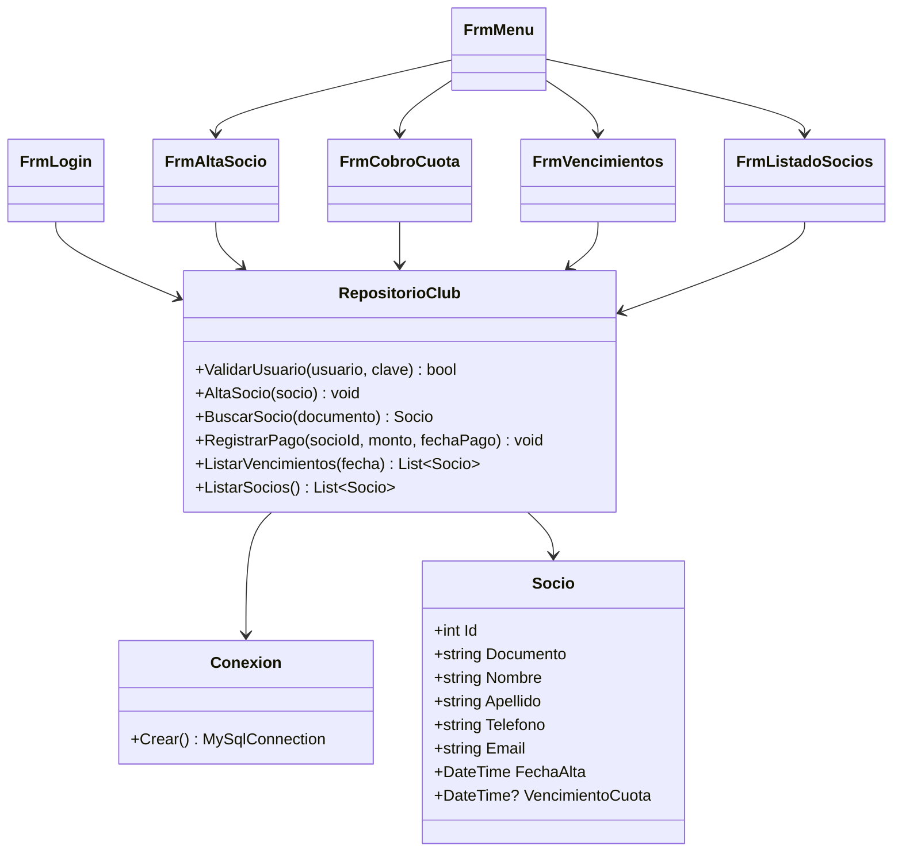
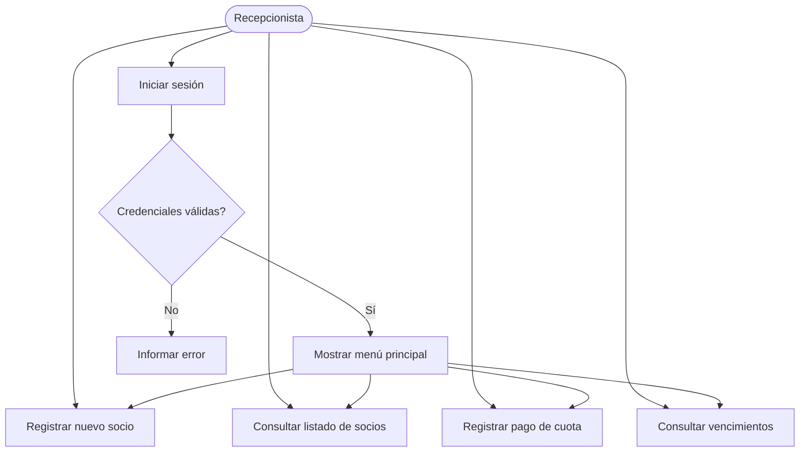

# Sistema de gestión del Club Deportivo — análisis y diseño

## 1. Problema y objetivo

El club necesita administrar el registro de socios y no socios, la entrega de carnet, el cobro de cuotas mensuales o diarias y el listado diario de socios cuya cuota vence. Cuando finaliza el período de pago, el socio no debe realizar actividades hasta regularizar su cuota. El período nuevo comienza el día siguiente al vencimiento anterior.

## 2. Alcance del primer entregable

Según la consigna de la Fase 5.1, el primer sub-sistema que se programa es el acceso a la ventana principal y el alta de nuevos socios, con conexión a MySQL. El proyecto incorpora además una primera versión de consulta de socios, registro de pagos mensuales y listado de vencimientos para apoyar las pruebas. El registro de no socios, carnet físico/digital y cobro diario quedan identificados como funcionalidades pendientes de completar en una siguiente iteración; no deben presentarse como terminadas.

## 3. Clases y atributos identificados

- **Socio**: id, documento, nombre, apellido, teléfono, email, fecha de alta, vencimiento de cuota.
- **Cuota/Pago**: id, socio, fecha de pago, monto, período desde, período hasta.
- **Usuario**: id, nombre de usuario, clave y estado activo.
- **RepositorioClub**: operaciones de acceso a datos: validar usuario, alta de socio, buscar/listar socios, registrar pago y consultar vencimientos.
- **Conexion**: creación de conexiones con la base MySQL.
- **FrmLogin**: captura credenciales y habilita el acceso.
- **FrmMenu**: permite acceder a las funciones principales.
- **FrmAltaSocio**: valida y registra un nuevo socio.
- **FrmCobroCuota**: busca al socio y registra un pago mensual.
- **FrmVencimientos**: lista cuotas vencidas hasta una fecha seleccionada.
- **FrmListadoSocios**: presenta los socios registrados.

## 4. Diagrama de clases (borrador)

## 5. Casos de uso

## 6. Prioridad de procesos

1. **Alta**: abrir la aplicación, validar el acceso y mostrar el menú principal.
2. **Alta**: conectar con MySQL y registrar un socio con documento único.
3. **Media**: buscar y listar socios.
4. **Media**: registrar pagos y actualizar la fecha de vencimiento.
5. **Media**: consultar socios con cuota vencida a una fecha determinada.
6. **Pendiente**: registro de no socios, emisión/registro de carnet y cobro diario.
7. **Pendiente**: impedir formalmente el acceso a actividades si la cuota está vencida; requiere que el sistema gestione también las inscripciones/actividades.

## 7. Reglas de negocio que deben probarse

- Documento del socio obligatorio y único.
- Nombre y apellido obligatorios.
- El monto de pago debe ser mayor que cero.
- El vencimiento de cuota se almacena en la base de datos.
- La consulta de vencimientos debe incluir los socios cuyo vencimiento sea igual o anterior a la fecha consultada.
- El período que sigue a un vencimiento empieza al día siguiente del vencimiento anterior.
- No se debe afirmar que la aplicación bloquea actividades hasta implementar el control sobre las inscripciones/actividades.

## 8. Supuestos y puntos a confirmar con la docente

- Si el carnet debe ser solo registrado o también imprimirse.
- Cómo se calcula el importe de la cuota mensual y la diaria.
- Si el nuevo vencimiento debe ser un mes calendario desde el comienzo del período o una fecha fija definida por el club.
- Qué datos mínimos se requieren para registrar a un no socio.
